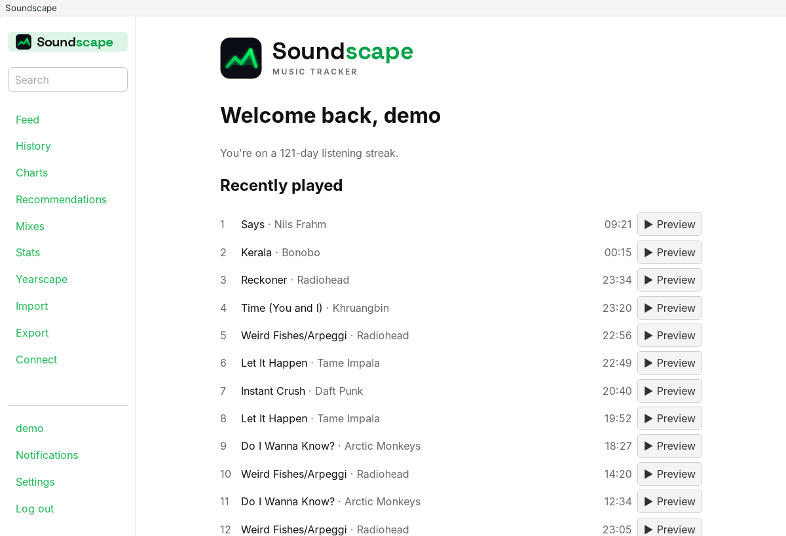

# Soundscape Desktop

A Linux desktop app for [Soundscape](https://github.com/novakr12/soundscape), the self-hosted music tracker. It opens your own Soundscape server in its own window, connects to it with a token of its own, sends what any music player on your computer plays, and shows your Soundscape notifications on the desktop. The window is drawn by the [Servo](https://servo.org) browser engine.



## What you need

- A Soundscape server new enough to have desktop app support (the `/api/info` address answers).
- To build it yourself: Rust, Python 3, a C and C++ compiler, and the development files for GStreamer, fonts, D-Bus and your graphics stack.

On Fedora:

```
sudo dnf install gcc gcc-c++ clang cmake m4 gperf python3 pkgconf dbus-devel freetype-devel fontconfig-devel harfbuzz-devel xz-devel systemd-devel libunwind-devel mesa-libGL-devel mesa-libEGL-devel wayland-devel libxkbcommon-devel libX11-devel libxcb-devel gstreamer1-devel gstreamer1-plugins-base-devel gstreamer1-plugins-bad-free-devel
```

On Ubuntu or Debian:

```
sudo apt install build-essential clang cmake m4 gperf python3 pkg-config libdbus-1-dev libfreetype6-dev libfontconfig-dev libharfbuzz-dev liblzma-dev libudev-dev libunwind-dev libgl-dev libegl1-mesa-dev libgles2-mesa-dev libwayland-dev libxkbcommon-dev libx11-dev libx11-xcb-dev libxcb-render0-dev libxcb-shape0-dev libxcb-xfixes0-dev libgstreamer1.0-dev libgstreamer-plugins-base1.0-dev libgstreamer-plugins-bad1.0-dev
```

Install Rust from [rustup.rs](https://rustup.rs) if you don't have it. The first build compiles Servo and takes a while; later builds only compile the app.

## Run it

```
cargo run --release
```

On first start it asks for your server's address, for example `https://music.example.com`. You log in on the next page and approve the connection; the app gets its own token, which shows up on Soundscape's Connect page as "Desktop app on" your computer's name. Change the server or sign out from Soundscape's Settings page, under **This app**. Signing out revokes the token.

Settings live in `~/.config/io.github.novakr12.SoundscapeDesktop/config.json`, readable only by you. The window's cookies and site data live in `~/.local/share/io.github.novakr12.SoundscapeDesktop/servo`.

To see how smoothly the window draws, start the app with a frame counter in its corner:

```
flatpak run --env=SOUNDSCAPE_SHOW_FPS=1 io.github.novakr12.SoundscapeDesktop
```

Quit it from the tray first, so the new start isn't handed to the copy already running. The number follows your screen's refresh rate while nothing is moving and drops when scrolling or an animation stutters.

## Keyboard shortcuts

| Keys | What they do |
|---|---|
| Ctrl+M | Open the mini player |
| Ctrl+, | Open Settings |
| Ctrl+R or F5 | Reload the page |
| Alt+← and Alt+→ | Back and forward (your mouse's back and forward buttons work too) |
| Alt+Home | Go to your server's home page |

## Scrobbling

The app picks up what Linux music players are playing through MPRIS, the standard every player supports: Spotify, Strawberry, Rhythmbox, Elisa, Lollypop, Amberol, VLC, mpv with the MPRIS plugin, and video sites in your browser.

- "Listening now" is sent as soon as a song starts. A play counts once you've heard half the song or four minutes, whichever comes first, the same rule as ListenBrainz and Last.fm. Songs under 30 seconds and paused time don't count, and a song you play again counts again.
- Browsers are off by default, so YouTube videos don't end up in your history. Turn any player on or off from the tray's **Players** menu or in Settings.
- When a browser is on, only songs count: videos titled "Artist - Song", topic and VEVO channels, and music sites that send the album, like YouTube Music. Titles are cleaned up, so "Radiohead - Creep (Official Video)" is scrobbled as Creep by Radiohead. Other videos and anything longer than 20 minutes are left out.
- While a song plays, the tray offers **♥ Love this song**, which marks it on your server (and on Last.fm, if your server sends there), and **Don't scrobble this one**, which keeps the current song out of your history. If you play it again later, it counts again.
- Untagged music files are tidied up: file endings and track numbers are dropped ("03 - Talisman.flac" becomes Talisman), underscores become spaces, and when there's no artist, "Artist - Song" in the name supplies it. Titles like "1999" or "7 rings" are left alone, and "Unknown Album" isn't sent.
- **Pause scrobbling for an hour**, in the tray and Settings, stops sending for 60 minutes and then turns itself back on, even across a restart. While it's paused, the same item says how long is left and resumes right away.
- When a player sends a wrong or messy name, choose **Fix this title…** in the tray. Settings shows exactly what the player sends; type the right artist and title, or tick the box to fix the artist on every song (handy for channels like "RadioheadVEVO"). The fix applies from then on, to now playing and scrobbles; plays already sent keep their old name. Fixes are listed in Settings, each with a Remove button, and stay on your computer.
- When the server can't be reached, plays wait in `waiting.jsonl` next to the settings and are sent with their original times once it's back.
- Links that lead off your server, like an artist's website or Bandcamp page, open in your web browser, including links meant for a new tab. In the Flatpak they go through the desktop's portal.

## Running in the background

Closing the window keeps the app running in the tray, so it keeps scrobbling. The window and its graphics memory are freed; the page itself stays loaded, so a song playing in it keeps playing. After a minute without music the page is set aside too, and it comes back where you left it when you open the window again from your apps or the tray. Opening the app a second time brings the running one forward instead of starting another. Quit from the tray. Turn this off in Settings ("Keep running when the window is closed").

When the window closes while music plays, the app's own player (GStreamer, which Flatpak's GNOME runtime already has) can carry it on: it starts quietly in step with the page, the two cross over in a third of a second, and then the page is set aside. Media keys, the mini player, the tray and the Discord status keep working, and full songs still count as plays. When you open the window again, the page loads at the song and second the app's player has reached, and takes over in step the same way. It streams through the server with the app's own token. It's on when "When the window is closed, keep the music playing with the app's own player" is ticked in Settings; without it, the page keeps playing in the background instead.

"Start when you log in, without opening the window" in Settings starts the app in the tray only; it scrobbles in the background until you open it from your apps. Outside Flatpak this writes `~/.config/autostart/io.github.novakr12.SoundscapeDesktop.desktop`; inside Flatpak it asks your desktop for permission instead.

The tray icon shows the song playing and today's plays. GNOME only shows tray icons with the AppIndicator extension (`sudo dnf install gnome-shell-extension-appindicator` on Fedora, then turn it on in Extensions).

## Notifications

New followers, friends passing you on the weekly leaderboard, new releases and play milestones show up as desktop notifications. The app checks about once a minute. The first check after you connect only notes what's already there, so you don't get a burst of old ones. Clicking a notification opens what it's about: the follower's profile, the artist, the leaderboard.

The tray shows a line like "Today: 42 plays · 2 h 51 min · 🔥 121-day streak", updated every minute and right after a play is sent. If you haven't played anything yet today, it reminds you that the streak is waiting. Turn on "Remind me at 21:00 if my streak is about to end" in Settings for a notification in the evening, once a day; it's off by default.

On Monday or Tuesday a notification sums up last week: plays, listening time, your most played artist and your place among friends. It comes once per week; turn it off in Settings.

In December (or in January, if the app wasn't running in December) a notification tells you your Yearscape for the year is ready, with your plays, hours, most played artist and new artists. Clicking it opens the Yearscape. It comes once a year; turn it off in Settings.

Once a day the app looks at the [releases page](https://github.com/novakr12/soundscape-desktop/releases) for a newer version. When there is one, a notification tells you once, and the tray gets a "Download Soundscape Desktop …" item that opens the download page. Nothing is downloaded or installed by itself; turn the check off in Settings.

## More from the tray

**Friends listening** shows who you follow is playing right now. Each friend has **▶ Play this song**, which opens the song in the window and plays it (the whole song if your Navidrome has it, otherwise the preview), and **Open profile**.

**Music** opens the Music tab with your Navidrome libraries and playlists. Below it, each Navidrome playlist has a ▶ item that opens the playlist and starts playing it from the top (shuffled if shuffle is on). The list refreshes every 5 minutes and needs a Soundscape server with the Music tab.

**Mini player** (also Ctrl+M) opens a small window that stays on top of other windows: the cover, the song, a seek bar you can click or drag, and previous, play/pause, next and ♥, plus shuffle and repeat for players that support them. Repeat goes from off to the whole queue to this song, like in Soundscape. While a song plays in the Soundscape window, a line below shows which song is up next in its queue. It follows whichever music player is playing (and stays on it while it's paused), and controls it the same way your media keys would. While a song plays in the Soundscape window, it shows and controls that instead. On GNOME with Wayland, "stay on top" depends on the desktop and may not work.

## Media keys, search and Discord

Songs you play in the window work with your keyboard's media keys and your desktop's media controls (play, pause, next, previous and seeking), and show up there with their cover. Clicking Soundscape in the media controls opens the window.

Your artists and songs show up when you search from GNOME's Activities overview or KDE's KRunner, with their play counts. Pick one to open it in the app, or in GNOME click the app icon to open the full search. This works while the app is running, which it usually is in the background. In GNOME you can turn it off under Settings → Search.

Your Discord status can show what you're playing, the way music apps do: "Listening to Soundscape" with the song, the artist, the album cover (album name on hover, or "Unknown album" when your Soundscape server doesn't know it) and a progress bar. Discord fetches the cover itself, so it has to be public: the player's own cover when it's on the web, or your Soundscape server's open cover address when the server uses https; otherwise the Soundscape logo shows instead. Discord needs an application of your own for it: create one called "Soundscape" at [discord.com/developers/applications](https://discord.com/developers/applications), turn on "Show what I'm playing in my Discord status" in Settings and paste the Application ID. The status clears when the music stops or you turn it off.

## Settings

Settings (Ctrl+, or from the tray) opens Soundscape's own Settings page in the window, with this app's settings under **This app**: scrobbling and players, title fixes, plays waiting to be sent with a Send now button, notifications, the Discord status, starting when you log in, keeping the app running when the window is closed, display options, changing the server and signing out. They sit next to your account, privacy and the player (volume levelling, crossfade). The app fills that section in itself, so it only shows inside the app and needs an up-to-date server. The version you have is at the top of This app, which also says when a newer one is out.

## Search from your desktop without Flatpak

The Flatpak sets search up for you. When you run the app from source, copy the files yourself. GNOME only reads search providers from system folders and needs the app's `.desktop` file installed:

```
sudo install -Dm644 flatpak/io.github.novakr12.SoundscapeDesktop.search-provider.ini /usr/local/share/gnome-shell/search-providers/io.github.novakr12.SoundscapeDesktop.search-provider.ini
sudo install -Dm644 flatpak/io.github.novakr12.SoundscapeDesktop.desktop /usr/local/share/applications/io.github.novakr12.SoundscapeDesktop.desktop
install -Dm644 flatpak/io.github.novakr12.SoundscapeDesktop.krunner.desktop ~/.local/share/krunner/dbusplugins/io.github.novakr12.SoundscapeDesktop.desktop
```

Log out and back in for GNOME to pick it up.

## Flatpak

The `flatpak` folder holds everything to build the app as a Flatpak: the manifest, the desktop entry, the store listing, and `cargo-sources.py`, which lists every Rust crate so the build can run without network access. The manifest also fetches the prebuilt SpiderMonkey library that Servo's JavaScript engine links against, so the offline build doesn't have to compile it.

To build and install it yourself (install `flatpak-builder` first; on Fedora `sudo dnf install flatpak-builder`):

```
python3 flatpak/cargo-sources.py
flatpak-builder --user --install-deps-from=flathub --install --force-clean flatpak/build-dir flatpak/io.github.novakr12.SoundscapeDesktop.yml
flatpak run io.github.novakr12.SoundscapeDesktop
```

CI builds the same Flatpak on every push and keeps it as `soundscape-desktop.flatpak` under the run's artifacts, which installs with `flatpak install --user soundscape-desktop.flatpak`.

The Flatpak may talk to music players (`org.mpris.MediaPlayer2.*`), the tray (`org.kde.StatusNotifierWatcher`) and notifications (`org.freedesktop.Notifications`), show its own media player for media keys (`org.mpris.MediaPlayer2.SoundscapeDesktop`), use your graphics card to draw the window, play sound, use the network and reach Discord's local socket (`xdg-run/discord-ipc-0`, and `xdg-run/app/com.discordapp.Discord` for the Discord Flatpak) for the Discord status. It can't see your files.

## Releases

Each release on GitHub has a ready-made Flatpak bundle. Download `soundscape-desktop-<version>-x86_64.flatpak` and install it with:

```
flatpak install --user soundscape-desktop-<version>-x86_64.flatpak
```

Flatpak fetches the GNOME runtime from Flathub if you don't have it yet. `SHA256SUMS` next to it lets you check the download with `sha256sum -c SHA256SUMS`.

To make a release:

1. Set the new version in `Cargo.toml` and `core/Cargo.toml`, run `cargo update -w`, and add a `<release>` with notes at the top of the metainfo's `<releases>`.
2. Commit and push, then tag the commit and push the tag:

   ```
   git tag v0.10.0
   git push origin v0.10.0
   ```

The release workflow checks that the tag, both `Cargo.toml` files and the metainfo agree, builds the Flatpak, and publishes the release with the notes from the metainfo.

## How it's put together

| Folder | What's in it |
|---|---|
| `src` | The window: Servo, keyboard and mouse input, the mini player's window, the background and single-copy handling |
| `core` | Everything else: scrobbling, the tray, notifications, media keys, search, Discord, the app's own player and the settings |
| `icons` | The app icon in every size the desktop needs |
| `flatpak` | The Flatpak manifest, desktop entry, store listing and release scripts |

## Useful commands

| Command | What it does |
|---|---|
| `cargo run --release` | Start the app |
| `cargo test --workspace --release` | Run the tests (`dbus-run-session -- cargo test --workspace --release` also runs the ones that talk to D-Bus) |
| `cargo clippy --workspace --all-targets --release -- -D warnings` | Lint |
| `cargo fmt --all` | Format the code |
| `cargo build --release` | Build an optimised binary in `target/release/soundscape-desktop` |

## License

[AGPL-3.0-or-later](LICENSE), like Soundscape.
